# KANT CH2 — Supabase 쇼핑몰 DB (회원·상품·주문 CRUD)

uv 기반 Python 프로젝트에서 Supabase(PostgreSQL)에 회원·상품·주문 테이블을 설계하고,
SQL 과 Supabase Python SDK 로 CRUD · 트랜잭션 · 사용자별 접근 제어(RLS)를 구현했습니다.

## 실행 방법
```bash
uv sync
cp .env.example .env   # SUPABASE_URL · SUPABASE_PUBLISHABLE_KEY · DEMO_PASSWORD 입력
# Supabase SQL Editor 에서 sql/01 → 05 순서로 실행 (계정 3개는 Dashboard 에서 먼저 생성)
# 06 · 07 은 검증 스크립트 (블록별 실행)
uv run main.py
```

## 테이블 구성 (ERD)
3개 도메인(회원·상품·주문) + 주문과 상품의 N:M 관계를 풀기 위해 정규화로 분리한 `order_items`.

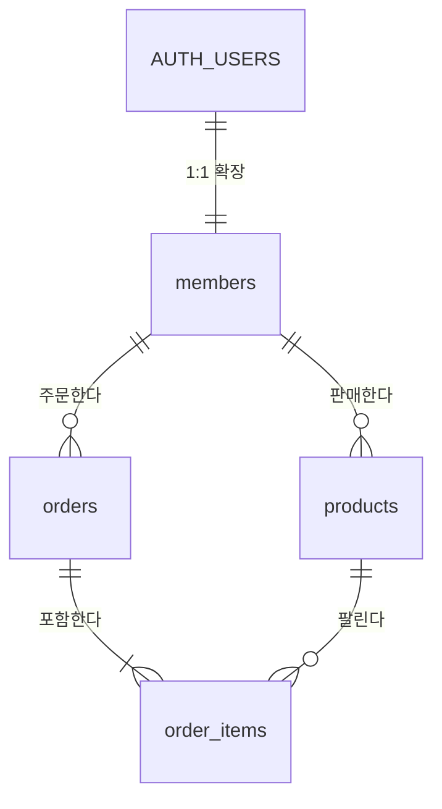

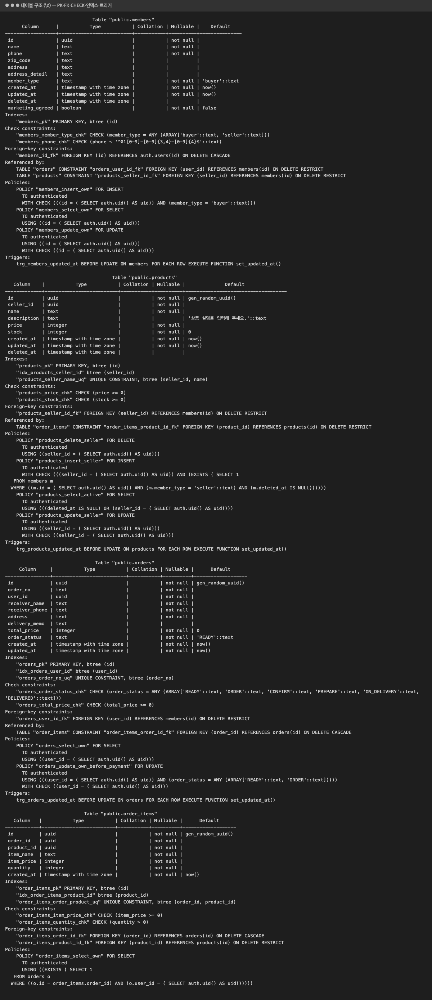

### members (회원)
| 컬럼 | 타입 | 제약 | 설명 |
|---|---|---|---|
| id | uuid | **PK**, **FK → auth.users.id** (ON DELETE CASCADE) | 인증 사용자와 1:1 |
| name | text | NOT NULL | 이름 |
| phone | text | NOT NULL, CHECK 010-0000-0000 형식 | 연락처 |
| zip_code / address / address_detail | text | | 주소 |
| member_type | text | NOT NULL, DEFAULT 'buyer', CHECK (buyer, seller) | 회원 유형 |
| marketing_agreed | boolean | NOT NULL, DEFAULT false | ALTER 로 추가 |
| created_at / updated_at / deleted_at | timestamptz | updated_at 트리거 | 감사·소프트 삭제 |

### products (상품)
| 컬럼 | 타입 | 제약 | 설명 |
|---|---|---|---|
| id | uuid | **PK**, DEFAULT gen_random_uuid() | |
| seller_id | uuid | NOT NULL, **FK → members.id** (RESTRICT) | 판매자 |
| name | text | NOT NULL, UNIQUE(seller_id, name) | 상품명 |
| description | text | DEFAULT 안내 문구 | |
| price | integer | NOT NULL, CHECK ≥ 0 | 가격 |
| stock | integer | NOT NULL, DEFAULT 0, CHECK ≥ 0 | 재고 |
| created_at / updated_at / deleted_at | timestamptz | | 판매 중지 = 소프트 삭제 |

### orders (주문)
| 컬럼 | 타입 | 제약 | 설명 |
|---|---|---|---|
| id | uuid | **PK** | 내부 키 |
| order_no | text | NOT NULL, UNIQUE | 외부 주문번호 |
| user_id | uuid | NOT NULL, **FK → members.id** (RESTRICT) | 주문자 |
| receiver_name / receiver_phone / address | text | NOT NULL | 수령인 |
| delivery_memo | text | | 배송 메모 |
| total_price | integer | NOT NULL, DEFAULT 0, CHECK ≥ 0 | 총액 (RPC 만 기록) |
| order_status | text | NOT NULL, DEFAULT 'READY', CHECK 6단계 | 주문 상태 |
| created_at / updated_at | timestamptz | | |

### order_items (주문상품)
| 컬럼 | 타입 | 제약 | 설명 |
|---|---|---|---|
| id | uuid | **PK** | |
| order_id | uuid | NOT NULL, **FK → orders.id** (CASCADE) | |
| product_id | uuid | NOT NULL, **FK → products.id** (RESTRICT) | |
| item_name / item_price | text / integer | NOT NULL | 주문 당시 스냅샷 |
| quantity | integer | NOT NULL, CHECK > 0 | |
| (order_id, product_id) | | UNIQUE | 한 주문에 같은 상품 한 줄 |

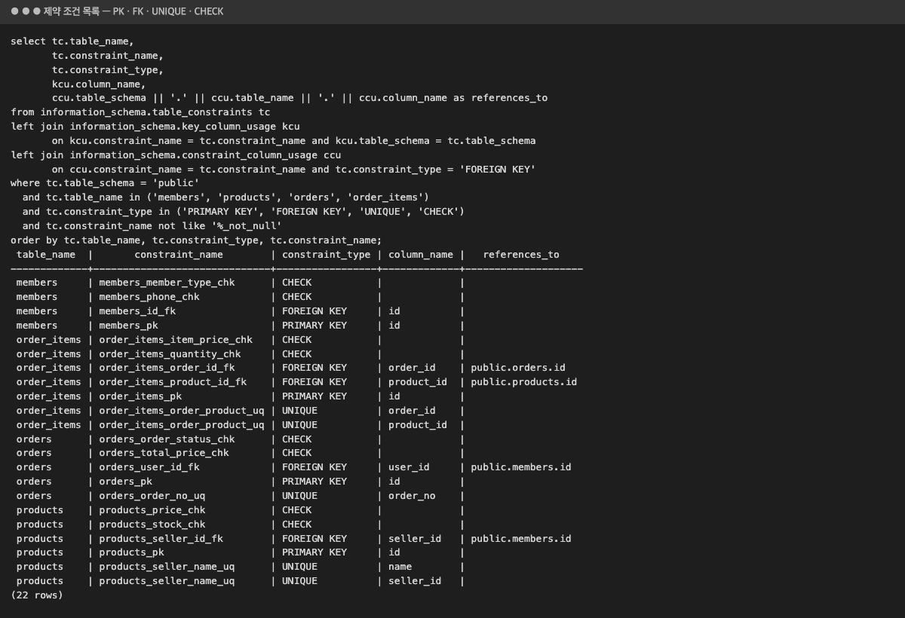

## 설계 원칙
- 명명 규칙: 테이블 소문자·복수형·snake_case / FK `{대상}_id` / 제약 `{테이블}_{컬럼}_{pk|fk|uq|chk}` / 인덱스 `idx_{테이블}_{컬럼}`
- 정규화: 주문상품 분리(1NF), 회원 이메일은 auth.users 에만(중복 제거), 주문 당시 가격은 스냅샷으로 의도적 보관

## 데이터 변경 검증 (INSERT · UPDATE · DELETE)
`sql/06_dml_verify.sql` — 변경 전 SELECT → 변경(RETURNING) → 변경 후 SELECT, 그리고 제약 위반 5건(NOT NULL · CHECK · FK · UNIQUE · CHECK)이 모두 거절되는지 확인.

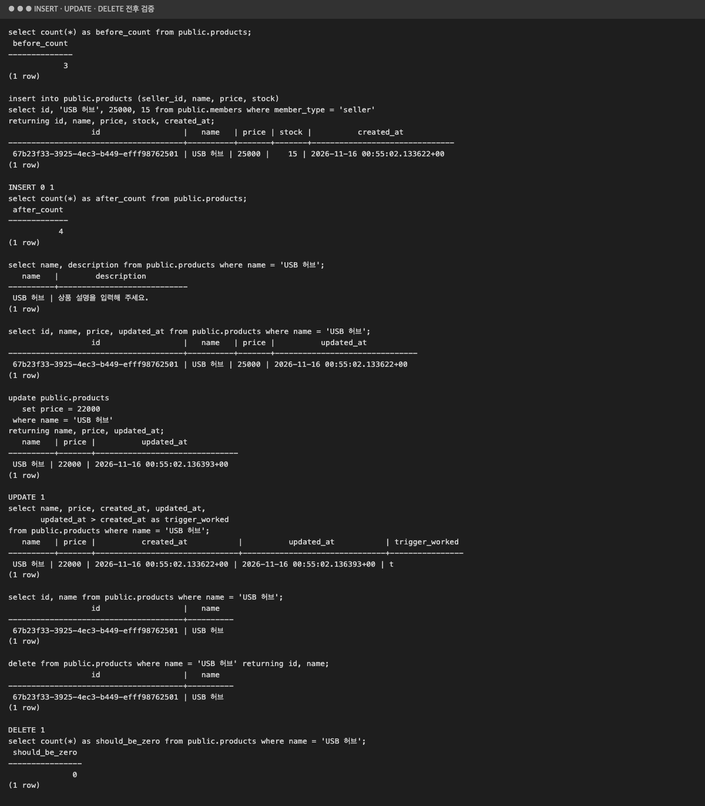
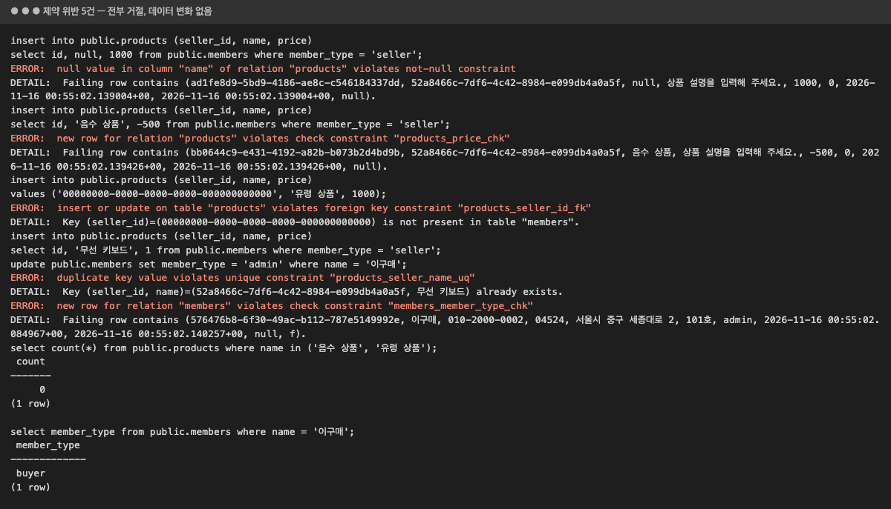

## 접근 제어 (RLS)
| 테이블 | SELECT | INSERT | UPDATE | DELETE |
|---|---|---|---|---|
| members | 본인 | 본인 · buyer 로만 | 본인 (member_type 열 제외) | ✗ (소프트 삭제) |
| products | 판매 중 전체 + 본인 상품 | 판매자 본인 | 판매자 본인 | 판매자 본인 |
| orders | 본인 | ✗ (RPC 전용) | 본인 · 결제 전 · 배송 정보 열만 | ✗ (RPC 전용) |
| order_items | 내 주문의 줄 | ✗ | ✗ | ✗ |

테이블 권한(GRANT)은 필요한 작업만 명시적으로 부여하고, 행은 RLS 정책이, 열은 열 단위 GRANT 가 제한합니다.

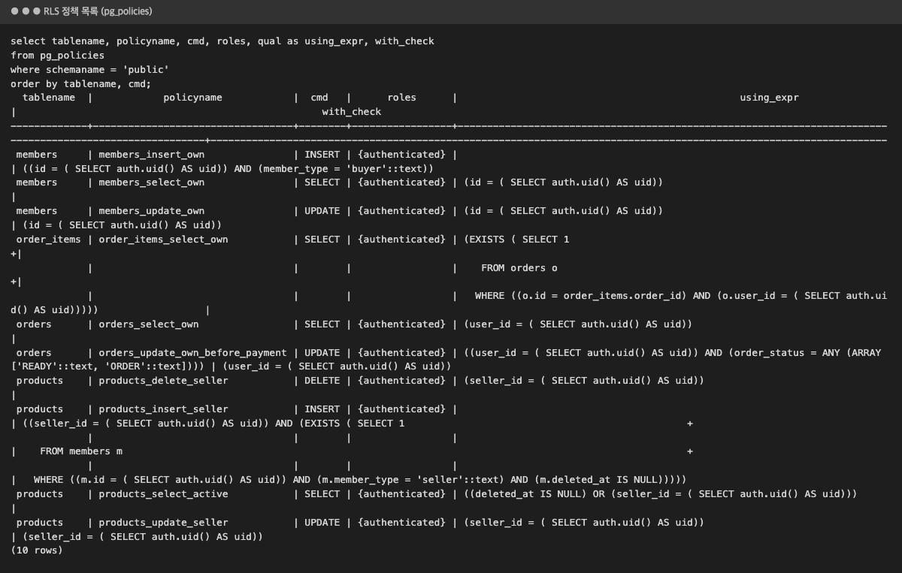

## 트랜잭션
- `create_order` RPC: 주문서 → 재고 차감 + 주문상품 스냅샷 → 총액, 하나라도 실패하면 전체 무효
- `cancel_order` RPC: 재고 복구 + 주문 삭제
- `sql/07_transaction_test.sql`: COMMIT / ROLLBACK / 중간 실패 시 부분 반영 없음

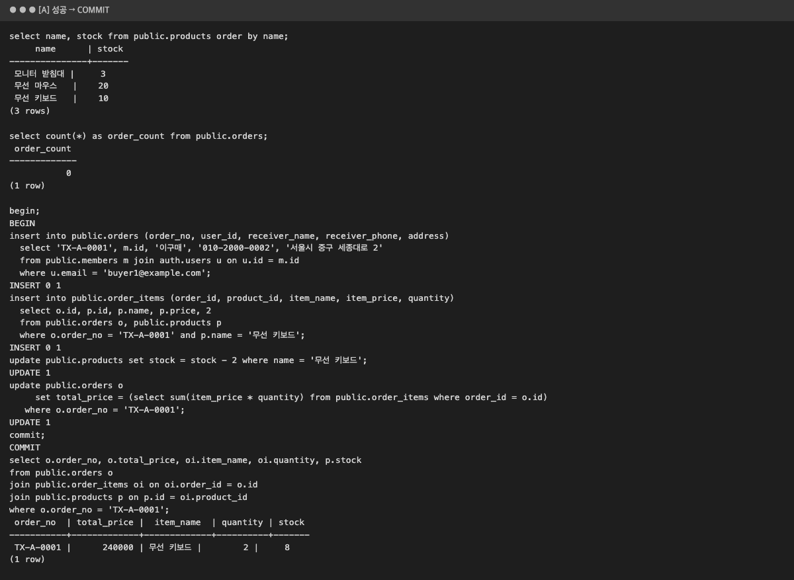 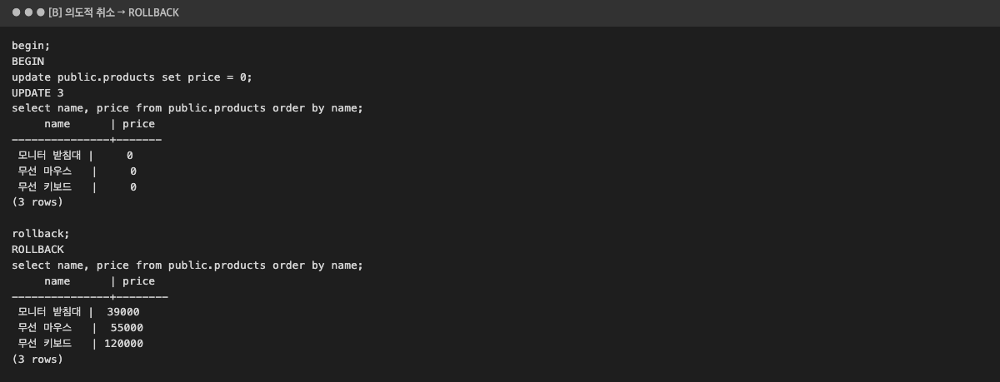 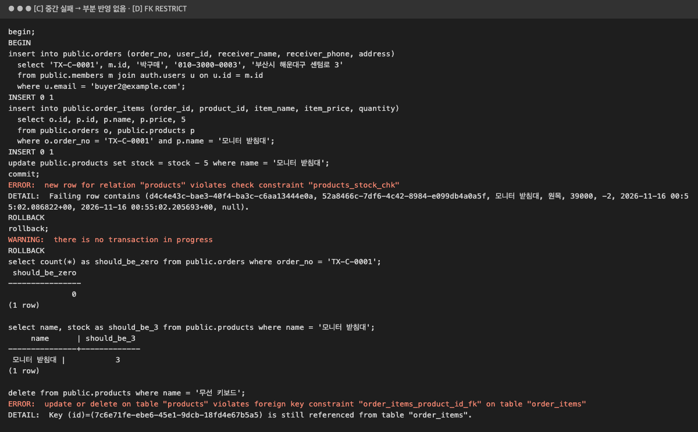

## CRUD 동작 화면
| 동작 | 캡처 |
|---|---|
| 회원 조회·수정 / 금지된 열 수정 거절 | 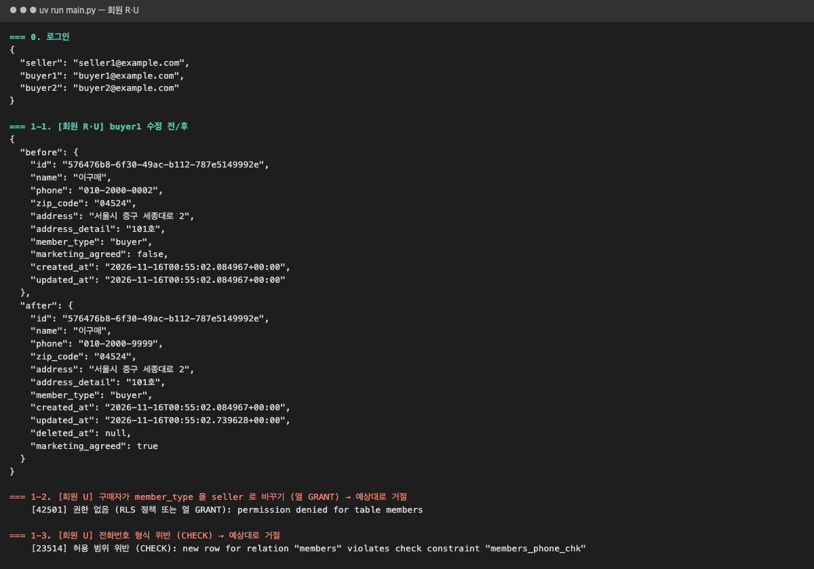 |
| 상품 등록·수정·조회 / 구매자 등록 거절 | 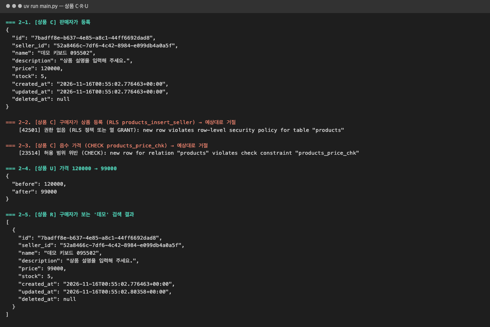 |
| 주문 생성 (재고 차감) | 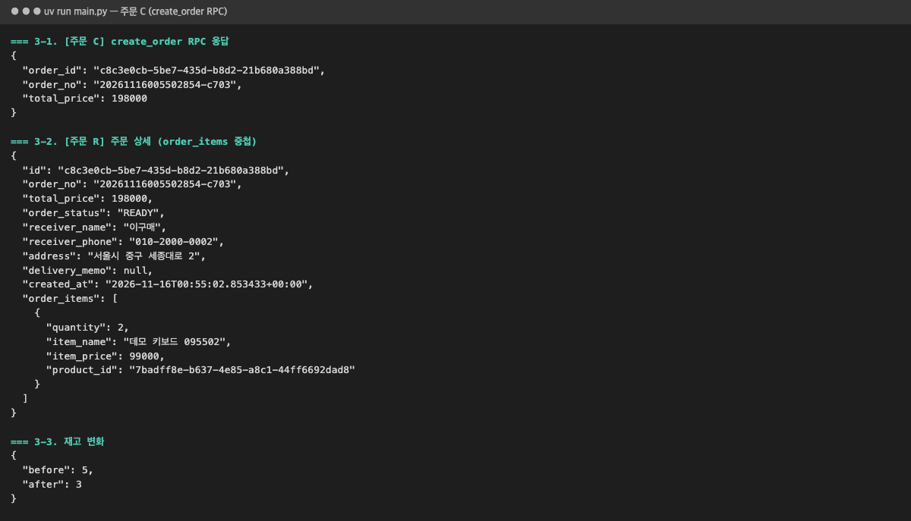 |
| 재고 초과 주문 → 롤백 검증 | 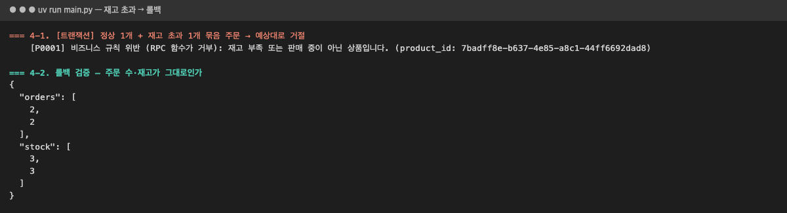 |
| 다른 사용자 주문 접근 차단 (RLS) | 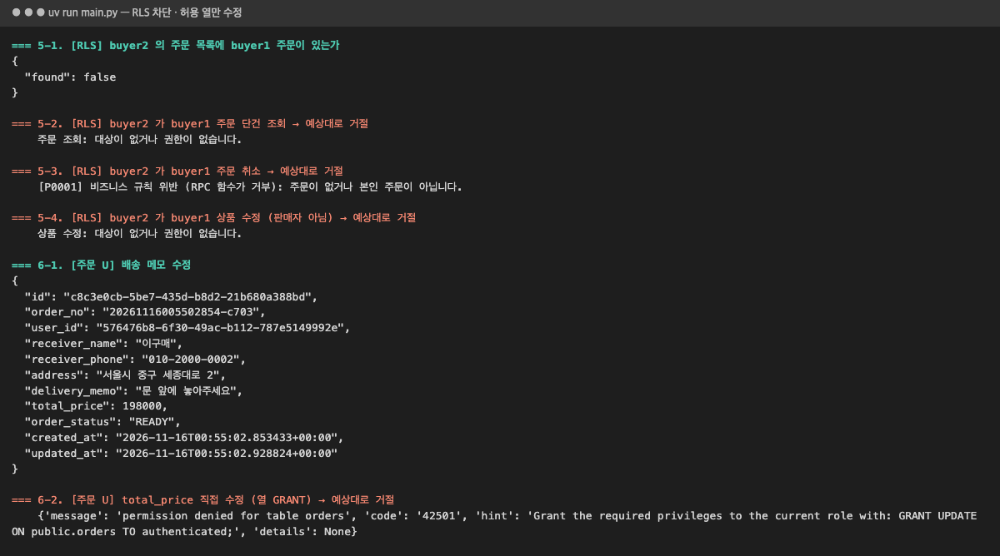 |
| 주문 취소 (재고 복구) · 상품 삭제 (소프트/하드) | 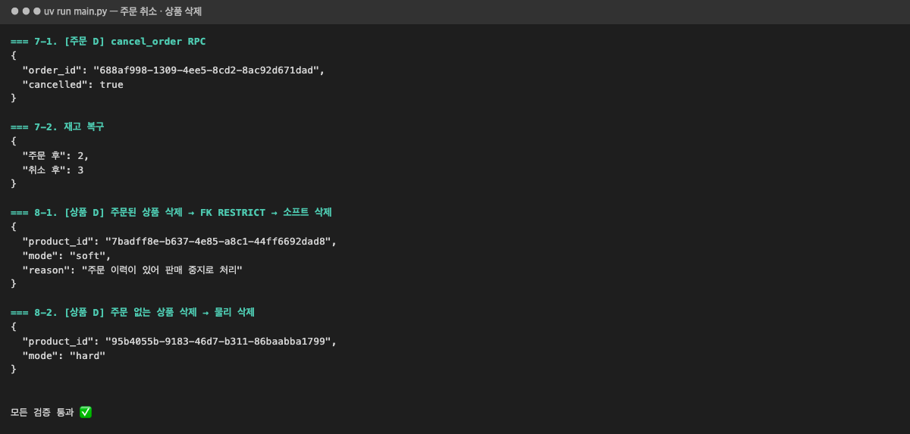 |

## 예외 처리
| SQLSTATE | 의미 | 앱 처리 |
|---|---|---|
| 23502 / 23514 | NOT NULL / CHECK 위반 | 메시지 출력 |
| 23503 | FK 위반 | 상품 삭제 시 소프트 삭제로 전환 |
| 23505 | UNIQUE 위반 | 메시지 출력 |
| 42501 | RLS·권한 거부 | 메시지 출력 |
| P0001 | RPC 비즈니스 규칙 위반 | 메시지 출력 (트랜잭션은 이미 롤백) |

## 검증 기록
전체 실행 로그와 검증 절차는 [docs/verification.md](docs/verification.md), 원본 로그는 `docs/logs/` 에 있습니다.
